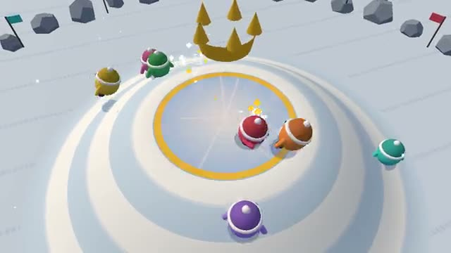

# King of the Hill

Hold the snowy hilltop alone. Shove everyone off. A multiplayer starter game from [Multiplayer Agent](https://multiplayeragent.com): 3D, party, 2–8 players, with bots that fill empty seats.

## How it plays

Every second you stand alone on the icy top of the hill scores a point; two or more up there and nobody scores. Shove the others down the slope, and the highest score when the clock runs out wins.

**Controls:** WASD or arrow keys to move and Space to shove, or the touch stick and Shove button.

## Make it yours in the Game Builder

Open the [Game Builder](https://multiplayeragent.com), choose **Start from a starter game** and pick King of the Hill. It opens as version 1 in your studio, ready to play and publish. Then ask for changes, for example:

- Make it a sandcastle on a beach
- Add a power-up snowball that knocks people further
- Make the hilltop move around the map every 20 seconds

## Run it yourself

1. Get a free publishable key (`pk_…`) at [multiplayeragent.com](https://multiplayeragent.com).
2. In `index.html`, put it in place of `pk_REPLACE_ME` in the `MP_CONNECT` block.
3. Serve the folder (for example `npx serve`) and open it. The 3D engine loads as a module, which browsers block from a file on disk.

Without a key it still runs, offline against bots.

## How it is built

- One `index.html` plus three.js in `libs/`. The comment at the top of the script maps the code and explains the multiplayer.
- **Host-run rules:** The host's browser decides every shove and counts every point; if it leaves, the next player takes over.
- **Bots:** Bots fill the hill until enough people join, climbing and shoving like players.
- **Live sync:** Everyone sees the same shoves, tumbles and scores as they happen.
- **Leaderboard:** The best scores anyone has made in one game, on the results card.
- The game length, the shove and the hill's size are in the `CONFIG` block; the hill's shape is `groundY()` in the `HILL` section.
- `?attract` runs it offline with bots only. The preview video is recorded from it.

## License

MIT. three.js in `libs/` is MIT too (Copyright 2010-2024 three.js authors).
